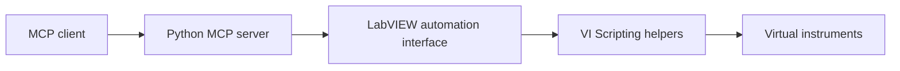

# LabVIEW MCP

Model Context Protocol integration for AI-assisted graphical programming and scientific instrumentation.

> Early-stage project. The implementation is not yet included in this repository. Installation and client configuration will be documented after source review.

## Motivation

Engineering teams rely on graphical programming and legacy instrumentation environments that are not readily accessible to text-oriented coding agents. This project aims to bridge MCP clients and LabVIEW through programmatic interfaces rather than desktop automation.

## Prototype capabilities

The maintainer reports a local prototype that inspects VI objects, modifies nodes and wires, saves virtual instruments, and executes them for validation. A reported test replaced an Add node with Multiply in an existing VI and reopened it from another process. These results have not yet been independently reproduced from this repository.

## Proposed architecture

## Development environment

Reported prototype: Windows, LabVIEW 2021 SP1 32-bit, Python 3.12, ActiveX/COM and VI Scripting. Compatibility with other versions is unverified.

## Documentation

- [Architecture](docs/architecture.md)
- [Roadmap](ROADMAP.md)
- [Contributing](CONTRIBUTING.md)
- [Security](SECURITY.md)

## License

Pending source ownership and licensing review. No open-source license has yet been selected.

LabVIEW is a product of NI. This is an independent project and does not imply endorsement by NI.
