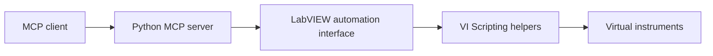

# LabVIEW MCP 2021

**Experimental Model Context Protocol (MCP) bridge for LabVIEW 2021 SP1 (32-bit) on Windows.**

> [!WARNING]
> **Work in progress (WIP) — v0.1.0-alpha preview.** This project is under active development. Installation and functionality are not yet fully validated; advanced VI Scripting relies on local helper VIs that are not redistributed here. Breaking changes are expected. Do not use it with production VIs or connected hardware.

## Source preview

The current Python source preview has been published as **[labview-mcp-public.zip](labview-mcp-public.zip)**. Download and extract the ZIP to work with the source files. They have not yet been committed individually to this repository.

The source preview is not a fully working standalone release. It excludes NI binary VIs, third-party scripting helpers, internal test fixtures, and generated environments.

## Project goals

- Expose LabVIEW graphical programming workflows to MCP-compatible AI clients.
- Inspect VI objects and programmatically edit block diagrams using ActiveX/COM and VI Scripting.
- Save and validate modifications to virtual instruments.
- Eventually document configurations for Claude Code, Codex, and OpenCode.

These are project goals and locally reported prototype capabilities, **not guaranteed features of the published preview**.

## Requirements and experimental setup

- Windows with National Instruments LabVIEW 2021 SP1 (32-bit).
- Python 3.11 or newer (Python 3.12 was used during prototype development).
- Local installation and authorization of any required VI Scripting helpers.

After extracting the source preview, from PowerShell in the extracted directory:

```powershell
py -3.12 -m venv .venv
.\.venv\Scripts\python.exe -m pip install -r requirements.txt
.\.venv\Scripts\python.exe server.py
```

This command is an **experimental starting point**, not a verified installation procedure. The original prototype used dependencies and helper VIs that are not included in the downloadable source preview.

## Planned architecture



## Documentation

- [Architecture](docs/architecture.md)
- [Roadmap](ROADMAP.md)
- [Contributing](CONTRIBUTING.md)
- [Security](SECURITY.md)

## Status and contributions

This repository is published to share ongoing early work and invite feedback. Issues and reproducible reports are welcome. There is currently no validated public release or established user community.

## License and attribution

Original project code is offered under the [MIT License](LICENSE). This does not grant rights to National Instruments components or other third-party packages. NI LabVIEW is separately licensed and is not included. This is an independent project, not affiliated with or endorsed by NI.
